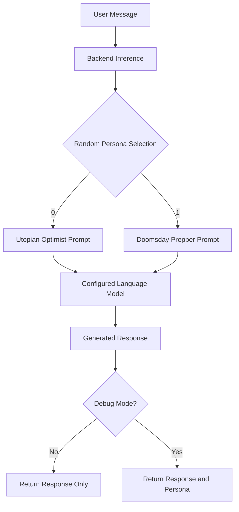

# Arithmatrix AVIP 2026 — Generative AI | Text Generation

**The Schizophrenic AI: One Prompt, Two Opposing Perspectives**

A generative AI application that responds to user messages using one of two contrasting AI personalities: **Utopian Optimist** or **Doomsday Prepper**. A backend coin flip randomly selects the personality for every request, creating an unpredictable conversational experience powered by a hosted large language model.

> **One question. Two worldviews. You never know which one will answer.**

---

## Live Demo

🚀 **Try The Deepfake Coder online:** [Launch the Web App](https://schizophrenic-ai.streamlit.app/)

Explore a statistical code-generation experiment that uses Markov chains trained exclusively on Python source code to produce syntactically valid yet semantically incoherent programs.

**Features available in the demo:**
- Generate Python code from custom seeds or prompts.
- Experiment with different generation settings.
- Explore the distinction between syntactic validity and semantic correctness.

**Note:** The app is hosted on Streamlit Community Cloud. It may take a short time to start if it has been inactive.

## Table of Contents

- [Overview](#overview)
- [Key Features](#key-features)
- [How It Works](#how-it-works)
- [AI Personalities](#ai-personalities)
- [Technology Stack](#technology-stack)
- [Model and Licensing](#model-and-licensing)
- [Project Structure](#project-structure)
- [Getting Started](#getting-started)
- [Usage](#usage)
- [Generating Deliverables](#generating-deliverables)
- [Evaluation](#evaluation)
- [Limitations and Failure Modes](#limitations-and-failure-modes)
- [Security and Best Practices](#security-and-best-practices)
- [Task Requirements Checklist](#task-requirements-checklist)
- [Author](#author)

## Overview

The Schizophrenic AI explores how system prompts influence the behavior, tone, framing, and interpretation of responses generated by a large language model.

For every incoming message, the backend randomly selects one of two opposing system prompts using Python's `secrets.randbelow(2)`. The selected prompt is passed to the language model alongside the user's message, and the resulting response is returned without revealing the chosen personality during normal operation.

The application combines prompt engineering, randomized inference, API integration, text generation, and qualitative evaluation in a single project.

**Core objective:** Demonstrate how a single language model can produce contrasting responses to the same input by changing its system-level instructions.

*Note: “Schizophrenic AI” is the project's creative title for its unpredictable, contrasting personalities. It is not intended to represent schizophrenia or people living with the condition.*

## Key Features

- **Dual-personality generation:** Two deliberately contrasting system prompts produce optimistic and pessimistic perspectives.
- **Backend randomness:** A secure random selection mechanism chooses the personality for each message.
- **Hidden personality selection:** The selected persona is concealed from the user during normal inference.
- **Debug mode:** Reveals the selected persona for testing and evaluation.
- **Hosted LLM integration:** Uses Google's Gemini API through an OpenAI-compatible endpoint.
- **Provider-agnostic design:** Configurable API endpoint, model identifier, and API key.
- **Command-line inference:** Generate responses directly from the terminal.
- **Interactive chat interface:** A Streamlit application provides a graphical way to interact with the model.
- **Automated sample generation:** Produces outputs for 26 diverse prompts and records associated metadata.
- **Evaluation pipeline:** Generates a concise report describing performance, observed behavior, and limitations.
- **Automated tests:** Includes sanity tests that can run without a live API key.

## How It Works

The application follows a simple inference pipeline:

1. The user submits a message.
2. The backend randomly selects one of the two system prompts.
3. The selected system prompt and user message are sent to the configured language model.
4. The model generates a response according to the selected personality.
5. The application returns the response, keeping the personality hidden unless debug mode is enabled.



The selection mechanism uses:

```python
import secrets

persona_index = secrets.randbelow(2)
```

Each call independently selects one of two persona indices. This provides an approximately equal probability of selection over many calls, but it does not guarantee that the two personalities will alternate or appear equally often in a small number of requests.

## AI Personalities

### 1. Utopian Optimist

The Utopian Optimist interprets questions through a hopeful, constructive, and progress-oriented lens.

**Behavioral characteristics:**
- Emphasizes innovation, cooperation, and human potential.
- Highlights opportunities, solutions, and positive outcomes.
- Frames technological and social challenges as solvable problems.
- Maintains an encouraging and forward-looking tone.

### 2. Doomsday Prepper

The Doomsday Prepper approaches questions through a cautious, skeptical, and risk-focused lens.

**Behavioral characteristics:**
- Highlights vulnerabilities, uncertainties, and potential threats.
- Considers worst-case scenarios and unintended consequences.
- Emphasizes resilience, preparedness, and contingency planning.
- Maintains a serious, skeptical, and cautionary tone.

Both personalities use the same underlying language model. The intended difference comes from their system prompts rather than separate models or independently trained checkpoints.

## Technology Stack

| Component | Technology |
|---|---|
| Programming language | Python |
| Language model | Google Gemini API |
| Model interface | OpenAI-compatible Chat Completions API |
| Default model identifier | `gemini-3-flash-preview` |
| Interactive interface | Streamlit |
| Configuration | Environment variables and `.env` |
| Random selection | Python `secrets` module |
| Sample generation | Custom Python scripts |
| Testing | `pytest` |
| Evaluation artifacts | Markdown, plain-text outputs, JSONL metadata |

## Model and Licensing

### Model information

- **Model identifier:** `gemini-3-flash-preview`
- **Provider:** Google
- **Deployment:** Hosted API; inference is performed remotely.
- **API compatibility:** Google's OpenAI-compatible endpoint.
- **Endpoint:** `https://generativelanguage.googleapis.com/v1beta/openai/`
- **API documentation:** https://ai.google.dev/gemini-api/docs/openai
- **API terms:** https://ai.google.dev/gemini-api/terms
- **API key:** https://aistudio.google.com/apikey

This project does not distribute model weights or claim ownership of the underlying language model. Model access, usage restrictions, and applicable terms are governed by the provider's policies.

**Licensing note:** The Gemini API is a hosted service rather than a locally distributed model checkpoint. Consult Google's current API terms for applicable usage and licensing conditions. The license of this project's source code is separate and should be specified independently if the repository is intended for public reuse.

### Provider configuration

The inference layer is designed to support compatible providers through environment variables:

- `LLM_BASE_URL` — API base URL.
- `LLM_MODEL` — Model identifier.
- `LLM_API_KEY` — Provider API key.

When switching providers, verify endpoint compatibility, model availability, request parameters, and applicable usage limits. Update the model information and evaluation report accordingly.

## Project Structure

```text
GAI_1_SchizophrenicAI_byte/
│
├── app.py                      # Streamlit chat interface
├── schizo.py                   # Main inference script / CLI
├── llm.py                      # Language model API integration
├── generate_samples.py         # Automated sample generation
├── evaluate.py                 # Evaluation report generator
├── prompts.txt                 # 26 diverse test prompts
├── requirements.txt             # Python dependencies
├── README.md                    # Project documentation
├── evaluation_summary.md        # Evaluation results (≤ 300 words)
├── .env.example                 # Environment variable template
├── .gitignore                   # Files excluded from version control
├── tests/                       # Automated sanity tests
│
└── generated_samples/
    ├── prompt_01.txt
    ├── prompt_01_meta.json
    ├── prompt_02.txt
    ├── prompt_02_meta.json
    ├── ...
    ├── prompt_26.txt
    ├── prompt_26_meta.json
    └── _meta.jsonl
```

*The tree illustrates the intended deliverables; exact filenames may vary with the implementation. Generated files should be committed after reviewing their contents.*

## Getting Started

### Prerequisites

Ensure the following are installed:

- Python 3.10 or a compatible version supported by the project's dependencies.
- Git.
- A Google Gemini API key, or credentials for another supported provider.
- An internet connection for hosted-model inference.

### 1. Clone the repository

Replace the placeholder with the actual repository URL.

```bash
git clone <your-repo-url>
cd GAI_1_SchizophrenicAI_byte
```

### 2. Create a virtual environment

**Windows PowerShell**

```powershell
python -m venv .venv
.\.venv\Scripts\Activate.ps1
```

**Linux / macOS**

```bash
python3 -m venv .venv
source .venv/bin/activate
```

### 3. Install dependencies

```bash
python -m pip install --upgrade pip
pip install -r requirements.txt
```

### 4. Configure environment variables

Create a local `.env` file using the example template:

```powershell
Copy-Item .env.example .env
```

For Linux or macOS:

```bash
cp .env.example .env
```

Add your configuration to `.env`, using the variable names supported by the project:

```dotenv
LLM_BASE_URL=https://generativelanguage.googleapis.com/v1beta/openai/
LLM_MODEL=gemini-3-flash-preview
LLM_API_KEY=your_api_key_here
```

Replace the placeholder with your actual API key.

Ensure that the application loads `.env` correctly and that the configuration names match those used in `llm.py`. If the implementation relies on environment variables alone, export them in your terminal or configure them through your deployment environment.

**Never commit `.env` or expose API keys in source code, screenshots, logs, or public repositories.**

## Usage

### Command-line inference

Submit a question directly to the inference script:

```bash
python schizo.py "What will cities look like in 2050?"
```

The backend selects a personality automatically. The selected persona remains hidden in normal operation.

### Debug mode

For development and testing, reveal the selected persona:

```bash
python schizo.py "What will cities look like in 2050?" --debug
```

Debug mode is intended for evaluation, not for the normal user experience.

### Interactive chat interface

Launch the Streamlit application:

```bash
streamlit run app.py
```

Open the local URL displayed in the terminal to interact with the application through the browser.

The interface provides a convenient way to submit different questions and observe the changing response styles.

## Generating Deliverables

The project includes an automated workflow for generating evaluation samples and producing a summary report.

### 1. Generate model outputs

```bash
python generate_samples.py
```

The script processes the prompts listed in `prompts.txt` and saves generated responses and associated metadata in `generated_samples/`.

The supplied prompt set contains 26 diverse questions spanning topics such as technology, society, education, climate change, and the future.

Each sample is intended to preserve the model's generated text as a plain-text artifact. Metadata records the selected persona and relevant inference statistics, such as token counts and latency, where available.

### 2. Generate the evaluation report

```bash
python evaluate.py
```

The evaluation script generates:

```text
evaluation_summary.md
```

The final report must remain within the assignment's 300-word limit. Review the generated samples and ensure that the qualitative observations accurately reflect the actual model outputs.

### 3. Run the test suite

```bash
python -m pytest -q tests
```

The tests should verify core application behavior, such as persona selection, configuration handling, and inference-related logic, without requiring a live API key where appropriate.

### Recommended execution order

```bash
python -m pytest -q tests
python generate_samples.py
python evaluate.py
```

After generation, review the output files, correct any inaccurate evaluation claims, and commit the final deliverables to the repository.

## Evaluation

The project evaluates the system at two levels.

### Quantitative observations

Where supported by the implementation, the evaluation artifacts record:

- **Token usage:** Input and output token counts, where returned by the provider.
- **Latency:** Time taken to generate each response.
- **Persona selection:** The selected personality for each sample.
- **Generation success:** Whether the request completed successfully.

### Qualitative assessment

The generated responses should be reviewed for:

- **Coherence:** Does the response address the user's question clearly?
- **Persona consistency:** Does the tone reflect the selected system prompt?
- **Contrast:** Do the two personalities frame similar questions differently?
- **Relevance:** Does the output remain connected to the original question?
- **Failure modes:** Does the model become repetitive, generic, exaggerated, contradictory, or factually unreliable?

BLEU is primarily a reference-based text-overlap metric, while perplexity measures a model's predictive uncertainty under a specified probability model. Neither metric alone establishes whether a response is coherent or whether a persona has been followed successfully. Any reported metric must be calculated using a documented method rather than estimated or invented.

The final `evaluation_summary.md` should report only metrics that were actually measured and qualitative findings supported by the generated samples.

## Limitations and Failure Modes

- **Prompt sensitivity:** The model may not consistently follow the intended personality.
- **Shared model behavior:** Both personas can produce similar answers despite contrasting instructions.
- **Randomness:** A random selection does not guarantee balanced persona counts in a small sample.
- **Generation variability:** Responses can differ between runs, even for identical inputs.
- **Factual reliability:** The model may generate inaccurate or unsupported claims.
- **API dependency:** Hosted inference requires network access, valid credentials, and available provider quota.
- **Latency and usage limits:** Request delays, rate limits, or exhausted quotas can interrupt generation.
- **Evaluation limitations:** A small set of 26 prompts cannot establish general performance across all possible inputs.

The application demonstrates prompt-conditioned text generation, not two separately trained intelligent agents. Its outputs should be understood as generated perspectives rather than reliable predictions of future events.

## Security and Best Practices

- Keep `.env` and `.streamlit/secrets.toml` out of version control.
- Store API credentials in environment variables or a managed secrets system.
- Do not hard-code credentials into Python files.
- Avoid logging API keys or other sensitive information.
- Handle API failures and rate limits gracefully.
- Keep debug output disabled during normal use.
- Review generated content before presenting it as factual information.
- Verify the provider's current terms, quotas, and supported model identifiers before deployment.

## Task Requirements Checklist

| Requirement | Deliverable | Status |
|---|---|---|
| Two contrasting system prompts | Persona definitions in inference code | Implemented in project design |
| Random backend selection | `schizo.py` / inference logic | Implemented in project design |
| At least 20 diverse prompts | `prompts.txt` (26 prompts) | Included |
| Generated output for each prompt | `generated_samples/` | Generate and review |
| Model and license/source links | This README | Documented |
| Inference script or API example | `schizo.py`, `llm.py` | Included |
| Interactive demonstration | `app.py` | Included |
| Evaluation of 300 words or fewer | `evaluation_summary.md` | Generate and verify |
| Automated sanity tests | `tests/` | Run before submission |
| Secure API configuration | `.env.example`, `.gitignore` | Verify before publishing |

## Author

**Anas Adeel — Generative AI**

This project demonstrates the practical application of system prompting, randomized persona selection, hosted large language model inference, and structured evaluation of generative AI outputs.

---

*Built for experimentation with prompt engineering and contrasting AI-generated perspectives.*